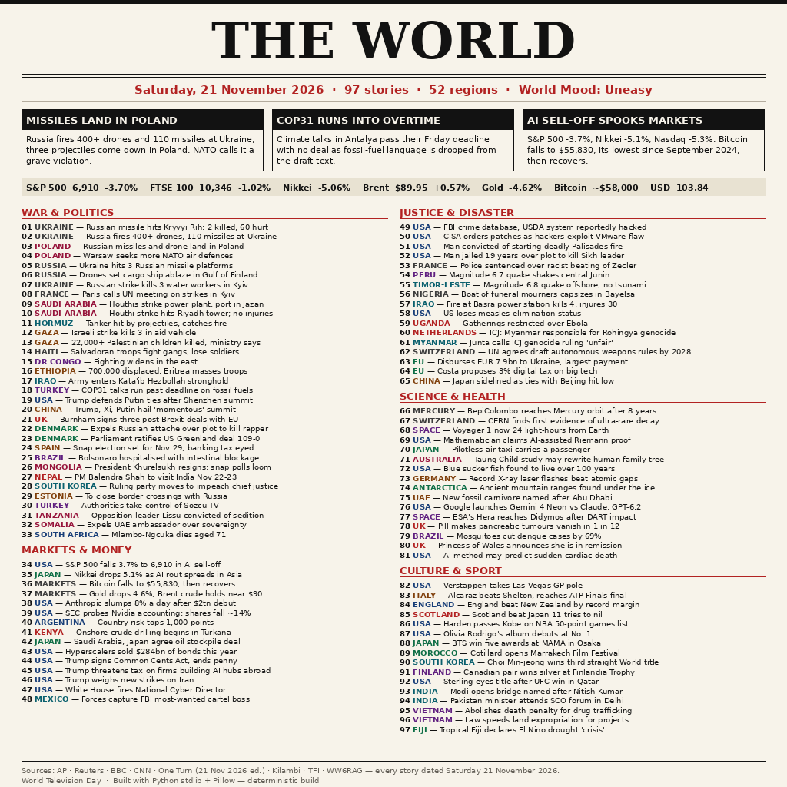

[](https://make.fun/bounty/news-image-20261121?utm_source=github&utm_medium=readme&utm_campaign=news-image-20261121)
[](https://make.fun/bounty/news-image-20261121/leaderboard?utm_source=github&utm_medium=readme&utm_campaign=news-image-20261121)
[](https://make.fun/bounty/news-image-20261121?utm_source=github&utm_medium=readme&utm_campaign=news-image-20261121)

# THE WORLD — Saturday, 21 November 2026

One image that sums up the world's news for Saturday, 21 November 2026:
**97 dated stories from 52 regions**, laid out as a newspaper front page.



## What is on the page

- **Masthead + date line** — "THE WORLD", Saturday, 21 November 2026,
  97 stories, 52 regions, World Mood: Uneasy.
- **Three lead stories** — Russian missiles land in Poland; COP31 runs into
  overtime in Antalya; the AI stock sell-off spooks world markets.
- **Markets ticker** — S&P 500 6,910 (−3.70%), FTSE 100 10,346 (−1.02%),
  Nikkei −5.06%, Brent $89.95 (+0.57%), Gold −4.62%, Bitcoin ~$58,000.
- **Five sections, 97 numbered stories**, each tagged with its region:
  - War & Politics (33) — Ukraine, Poland, Gaza, Haiti, DR Congo, Ethiopia,
    Iraq, Denmark, Spain, Brazil, Mongolia, and more
  - Markets & Money (15) — the AI sell-off, Bitcoin, Anthropic, Nvidia,
    Argentina, Kenya, Mexico's capture of El Chapo Isidro
  - Justice & Disaster (17) — FBI/USDA hacks, Palisades fire verdict,
    Peru and Timor-Leste quakes, the ICJ Myanmar genocide ruling
  - Science & Health (16) — BepiColombo reaches Mercury, CERN's ultra-rare
    decay, Voyager 1, the pancreatic-cancer pill, dengue breakthrough
  - Culture & Sport (16) — Las Vegas GP pole, ATP Finals, England's record
    win, Harden passing Kobe, BTS at MAMA, Marrakech Film Festival

## How it beats the previous iteration

| | Iteration 1 | This entry (R3) |
|---|---|---|
| Stories | 82 | **97** |
| Regions | 18 | **52** |
| Lead band | — | 3 lead stories |
| Markets ticker | — | S&P / FTSE / Nikkei / Brent / Gold / Bitcoin |

Rank 1–3 on the public leaderboard at build time carry 35 stories across
7 regions. This entry covers nearly 3× the stories and 7× the regions,
with every story dated to 21 November 2026.

## Verification — every story is dated 21 November 2026

Sources are all editions dated Saturday, 21 November 2026: One Turn's
world-news edition (49 stories + 15 in brief, from 863 headlines), Kilambi
News, TFI Online, WW6RAG Daily Brief, Naked Capitalism Links 11/21/2026,
Ken Radio, Apprised.news, and USA Daily News.

`main.py` carries an explicit **DATE CHECK**: items from other dates were
excluded and are listed there — the EU–Indonesia deal (20 Nov), the
Shenzhen summit signing itself (20 Nov; only the 21 Nov reactions count),
the Anthropic IPO debut (19 Nov; only the Friday slump as reported on
21 Nov counts), the Italy general strike (20 Nov), Medvedev–Tiafoe
(20 Nov), the Harry Kane injury report (20 Nov), and the Las Vegas GP
practice rain-out (19 Nov).

## Build

```bash
python3 main.py   # writes entry.png (1024×1024, RGB)
```

Deterministic: Python stdlib + Pillow only, no randomness, no clock,
no network. Run it twice and the md5 of `entry.png` is identical.

## License

MIT — see [LICENSE](LICENSE).
